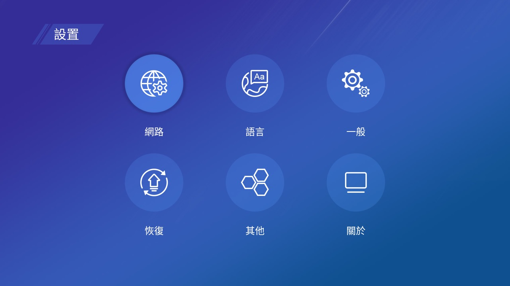
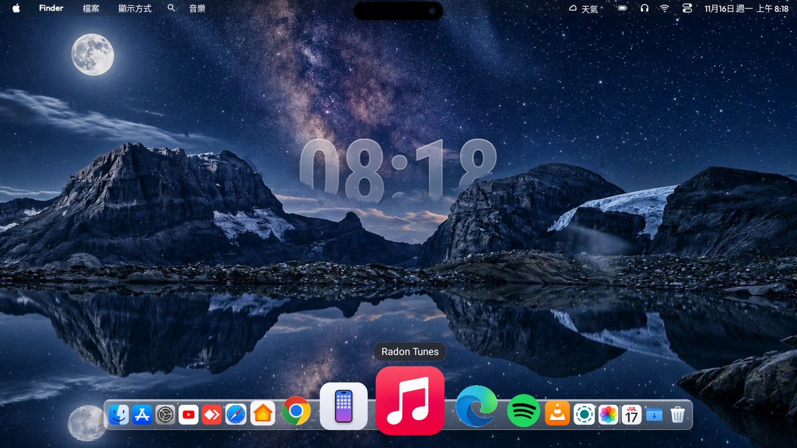
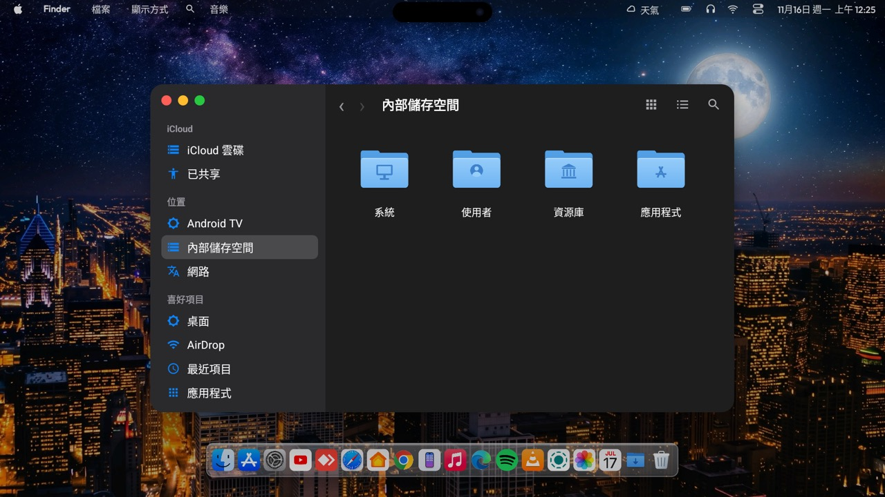
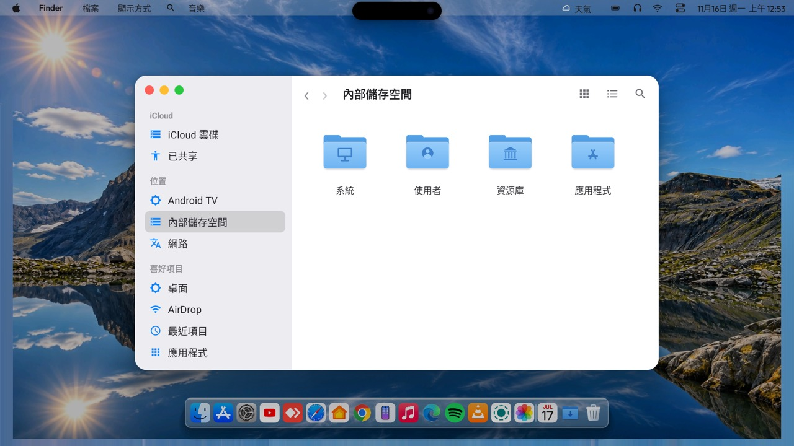
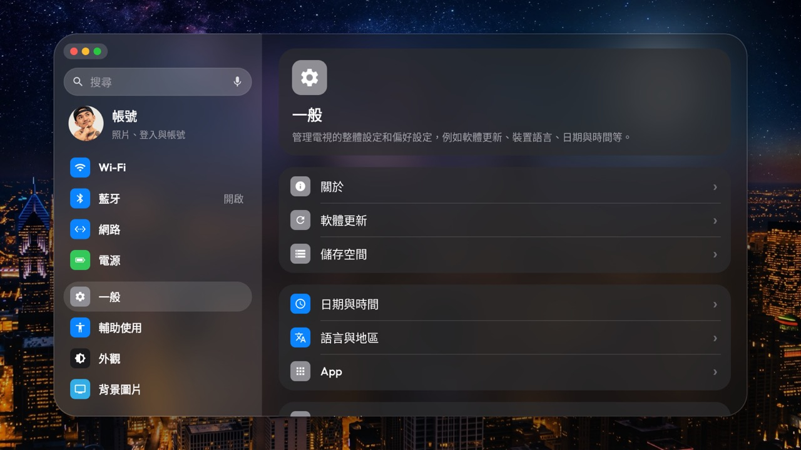
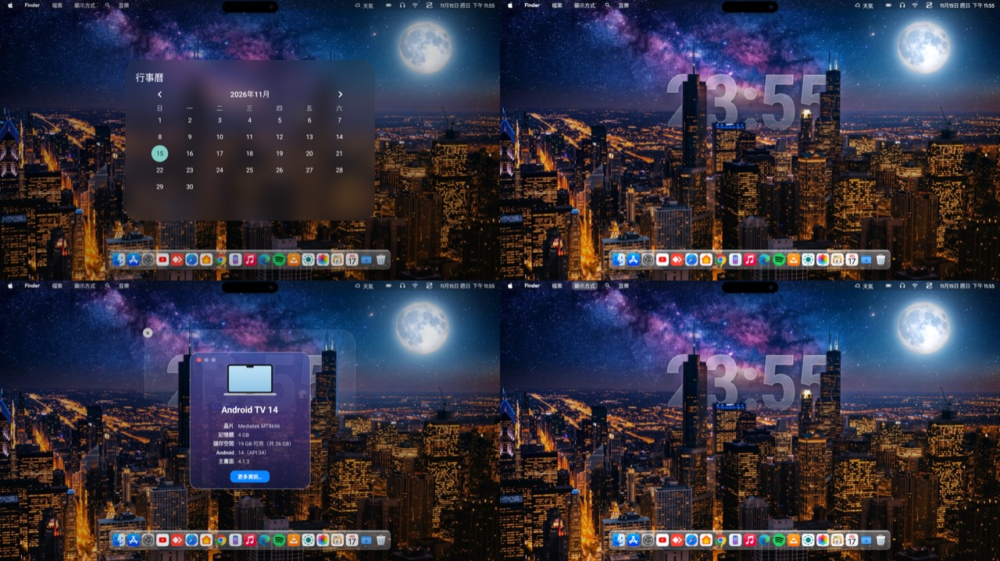
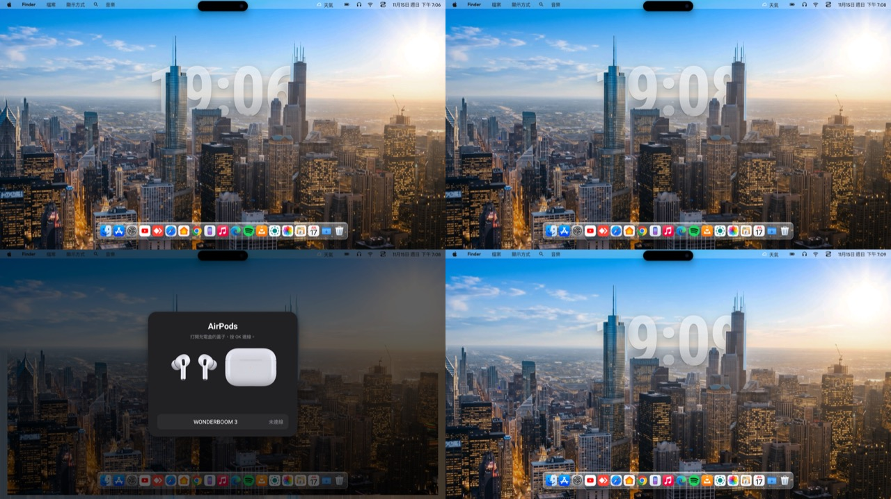
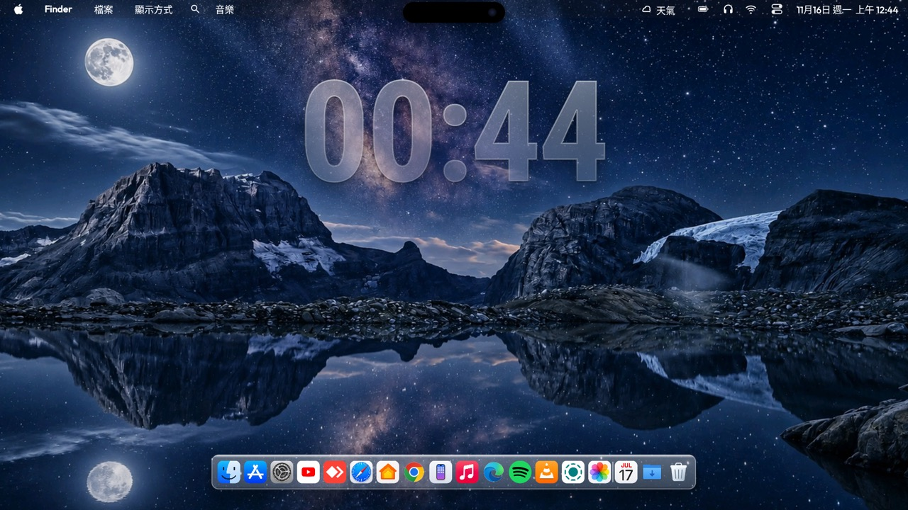
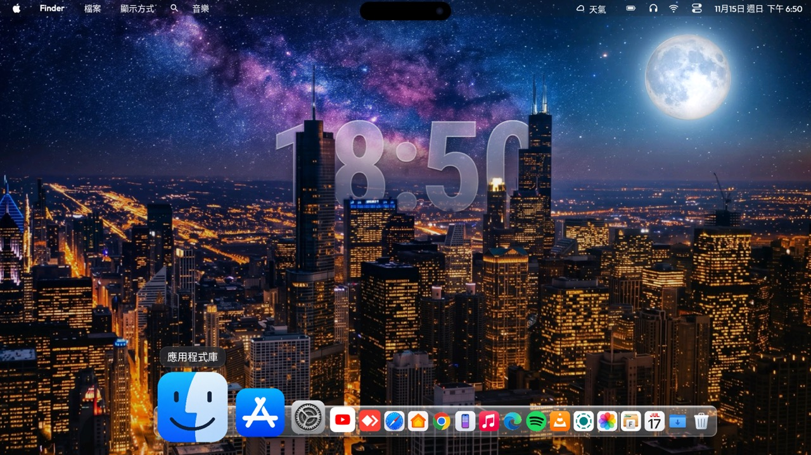
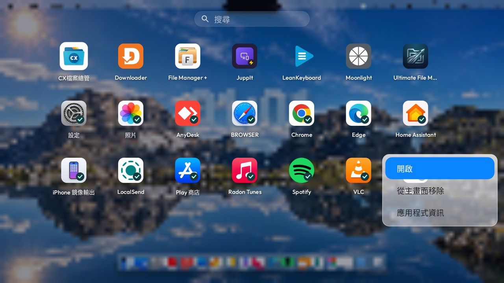

# Mac TVOS

把 Android TV／Google TV 的主畫面換成 macOS 風格：選單列、Dock、Finder、系統設定、照片、行事曆、景深時鐘，全部用遙控器操作。

- 最新版：**v40**，支援 **Android 9 以上**。
- 下載：[Releases](../../releases/latest) 的 `MacTVOS-v40.zip`（APK、一鍵安裝腳本、主題設定、去臃腫提示詞）。
- 實測機型：Google TV Streamer（Android 14）、SAMPO 聯網電視（MediaTek，Android 9）。

---

## 目錄

1. [影片展示](#影片展示)
2. [改造前後](#改造前後對照)
3. [功能一覽](#功能一覽)
4. [安裝](#安裝)
5. [提示詞](#提示詞)
6. [注意事項與還原](#注意事項與還原)

---

## 影片展示

約 54 秒完整導覽（v40，EVAN 配音、繁中字幕）：主畫面 → 應用程式庫 → Finder → 系統設定 → 照片 → 行事曆 → AirPods → 控制中心 → 垃圾桶 → 下載 → 揭曉

https://github.com/user-attachments/assets/d59fb1b5-7d30-4fd2-8e03-aa0485931796

---

## 改造前後對照

### 改造前：原廠主畫面

| SAMPO 原廠主畫面 | 原廠系統設定 |
|---|---|
|  |  |

原廠主畫面是一排排訊號源和 App 方塊，設定是一格格的大圖示。Google TV 原廠主畫面則是推薦影片牆。

### 改造後：Mac TVOS

**Google TV Streamer（Android 14）**



**SAMPO 電視（Android 9）**


上方是 macOS 選單列（Finder、檔案、顯示方式、搜尋、音樂、天氣、耳機、Wi-Fi、控制中心、日期時間），中間是景深時鐘，下方是 Dock。兩台用同一份主題設定。

---

## 功能一覽

### Finder（選單列「檔案」）

依外觀自動切換深色／淺色。側欄有 iCloud、Android TV、內部儲存空間、網路、桌面、AirDrop、最近項目、應用程式。

| 深色 | 淺色 |
|---|---|
|  |  |

### 系統設定

側欄照 macOS 順序排列：Wi-Fi、藍牙、網路、電源、一般、輔助使用、外觀、背景圖片、桌面與 Dock、選單列、顯示器、智能助理與 Siri、Spotlight、通知、聲音、鎖定畫面、隱私權與安全性、螢幕保護程式。開啟時預設在「一般」。



### 照片

半透明玻璃視窗，跟隨外觀深淺色。「年／月／所有照片」在上方，側欄有喜好項目、最近儲存、影片、截圖、人物、最近刪除。點開單張照片會全螢幕顯示在最上層。

| 深色 | 淺色 |
|---|---|
|  |  |

### 行事曆與關於這台電視

點選單列右上的日期或 Dock 的行事曆，跳出模糊桌布背景的月曆小卡；再點一次、點卡片外、按返回都會關閉。「關於這台電視」顯示型號、記憶體、儲存空間、Android 版本。



### 垃圾桶：清理暫存、垃圾檔案、一鍵提速

點 Dock 的垃圾桶，標題顯示目前記憶體用量，下面三項：

| 功能 | 做什麼 |
|---|---|
| 清理暫存 | 清主畫面自己的快取，再開系統「清除應用程式暫存檔案」，清所有 App 的快取 |
| 垃圾檔案 | 刪除內部儲存的 `.tmp`、`.temp`、`.log` 和縮圖快取（保留 `.nomedia`），再清空媒體垃圾桶 |
| 一鍵提速 | 結束其他 App 的背景程序，顯示釋放了多少記憶體 |

| 選單 | 垃圾檔案 |
|---|---|
|  |  |
| **一鍵提速** | **清理暫存** |
|  |  |

### AirPods 卡片

點選單列的耳機圖示，顯示藍牙耳機卡片（需要藍牙權限，安裝腳本會授予）。



### 景深時鐘

時鐘放在天空區域，被大樓擋住，看起來在建築後面。時間補零顯示（例：`08:05`），可拖動位置，「重設位置」回到置中。



### 夜景桌布



### 淺色長按選單

應用程式庫的長按選單和所有下拉選單，淺色外觀時改成淺色毛玻璃、深色字、藍色焦點列。



---

## 安裝

1. 電視：設定 → 系統 → 關於 → 連按「Android TV 作業系統版本」7 次 → 開發人員選項 → 開啟「USB 偵錯」與「網路偵錯」。查電視 IP。
2. 電腦：安裝 [platform-tools](https://developer.android.com/tools/releases/platform-tools)，解壓 `MacTVOS-v40.zip`。
3. 執行：

```bash
./install.sh <電視IP>
```

```bash
./apply-theme.sh <電視IP>
```

4. 電視跳出「允許 USB 偵錯？」時勾「一律允許」。

`install.sh` 會：上傳 APK、比對 md5（不一致自動重傳）、安裝、依 Android 版本授予檔案權限（11 以上用 appops，9／10 用 pm grant）、授予照片／藍牙權限、設為預設主畫面。

---

## 提示詞

以下提示詞貼給 Claude Code（或其他能執行指令的 AI）就能照做。改掉第一行的 IP 和資料夾。

### 1. 完整版：去臃腫 + 安裝 Mac TVOS + 檢查

```text
電視 IP：192.168.x.x（埠 5555）。安裝包位置：~/Downloads/MacTVOS-v40（改成你的資料夾）。
請當我的電視助手，用 ADB 幫我「去臃腫、安裝 Mac TVOS、檢查功能」，規則如下：

【連線】
1. 找 adb（沒有就先問我再從 Google 官方下載 platform-tools），adb connect <IP>:5555；電視跳授權就叫我按允許。連不上先 ping 和測 5555 埠，告訴我是沒開機、沒開網路偵錯還是 IP 錯。
2. 先回報：型號、Android 版本、目前主畫面 App、螢幕保護程式、可用記憶體與儲存空間、有幾個使用者帳號。

【備份，確保可還原】
3. 動手前把 `pm list packages -d` 和 `pm list packages -e` 存成本機檔案（含日期），並記下目前 HOME 與螢幕保護程式設定（`settings get secure screensaver_components`）。

【去臃腫】
4. 列出可停用的項目，分成「建議停用／看你需求／不建議動」三類。每個選項的標題直接寫出 App 名稱與套件名，不要藏在說明裡；說清楚停用後會少了什麼功能。
5. 只用 `pm disable-user --user 0`，不解除安裝系統 App；第三方 App 才可用 `pm uninstall --user 0`。全部要我勾選確認後才執行。
6. 絕對不要動：目前使用中的主畫面、輸入法、Play 服務與商店、系統設定、網路、藍牙、遙控器服務、媒體與相片相關元件（例如 com.android.gallery3d）、螢幕保護程式正在用的 App、其他使用者帳號。
7. 停用前先查依賴：主畫面、Dock、桌布、相簿、螢幕保護程式是否用到它；有疑慮就列為「不建議動」。

【安裝 Mac TVOS】（不需要就刪掉這段）
8. 先問我要不要裝。要的話執行 `install.sh <IP>`，再執行 `apply-theme.sh <IP>`。腳本失敗就改成逐條執行同樣的指令，並告訴我哪一步失敗。
9. 原廠啟動器先不要停用；確認 Mac TVOS 正常當主畫面後，再問我要不要停用原廠啟動器。
10. 裝完確認：按 HOME 回到 Mac TVOS、Dock 圖示齊全、選單列「檔案」能開、垃圾桶選單有「清理暫存／垃圾檔案／一鍵提速」、時鐘顯示 00:00 格式。

【檢查並截圖】
11. 逐項實測並截圖給我：主畫面、系統設定、YouTube、Play 商店、相簿／照片、螢幕保護程式、語音搜尋（若保留）。用 `screencap` 存在電視上再一次拉回，不要逐步來回。
12. 送按鍵前先截圖確認我沒在用電視；畫面有開著的視窗就先停，問我。啟動器設定視窗裡用方向鍵加確認鍵，不要用 tap（tap 會變成捲動）。
13. 有任何功能異常，立刻用 `pm enable <套件>` 還原該項，再回報原因。

【回報】
14. 用表格列出：已停用、已保留、已安裝、還原指令，以及備份檔位置。全程用繁體中文、精簡回答。

【可調整】
- 只想保守處理：加一句「只停用建議停用類」。
- 想更徹底：加一句「看你需求類也列給我逐項選」。
- 只去臃腫不裝啟動器：加一句「不要安裝 Mac TVOS」。
- 要保留的 App：在這裡列出 → 保留：
```

### 2. 只安裝 Mac TVOS

```text
電視 IP：192.168.x.x（埠 5555）。安裝包在 ~/Downloads/MacTVOS-v40。
請用 ADB 幫我安裝 Mac TVOS：
1. adb connect，回報型號、Android 版本、目前主畫面。
2. 先記下目前主畫面（cmd package resolve-activity -c android.intent.category.HOME），方便還原。
3. 執行 install.sh <IP>，再執行 apply-theme.sh <IP>；腳本失敗就逐條執行並告訴我哪一步失敗。
4. 原廠啟動器不要停用。
5. 截圖確認：按 HOME 回到 Mac TVOS、Dock 圖示齊全、選單列「檔案」能開、垃圾桶有三項。
6. 全程繁體中文，用表格回報，附還原指令。
```

### 3. 兩台電視同步成一樣

```text
A 電視 IP：192.168.x.x，B 電視 IP：192.168.y.y，兩台都已裝 Mac TVOS。
請把 B 調成和 A 一樣：
1. 用 content read --uri content://com.gathin.tvnext.theme/config.json 讀兩台主題設定並比對。
2. 列出 A 的 Dock 有、B 沒裝的 App，查每個 App 在 A 上的 minSdk 和 CPU 架構，告訴我哪些能直接從 A 複製到 B（pm path + adb pull，再 install-multiple）。
3. 讓我勾選要複製哪些，再安裝。
4. B 的設定、相簿、瀏覽器套件名如果不同，幫我加進 app_banners 對應到 Mac 圖示，並把 B 原本的設定先存一份。
5. 寫入後更新 theme_revision、重啟主畫面，截圖給我看。
```

### 4. 請 AI 改功能（改包）

```text
我有 Mac TVOS 的 apktool 解包資料夾（smali）。請幫我改：<要改的功能>。
規則：
1. 先找出相關的 smali 類別，說明現在怎麼運作，再動手。
2. 修改前把原檔備份成 .bak。
3. 舊 Android 沒有的 API 要用 Build.VERSION.SDK_INT 判斷，不能直接呼叫。
4. 打包 → zipalign → apksigner 用我的金鑰簽章，不要把金鑰密碼寫進任何檔案。
5. 安裝用「上傳、比對 md5、電視端 pm install -r」，不要直接 adb install。
6. 在電視上實測並截圖，沒測到的項目要明講。
```

---

## 注意事項與還原

- **一定要留一個主畫面**：停用或移除 Mac TVOS 前，先啟用原廠啟動器。
- **相片元件不要停用**（例：`com.android.gallery3d`），否則 Dock 的「照片」會消失。
- **重新安裝要重給權限**：檔案（Android 11 以上 `appops set com.gathin.tvnext MANAGE_EXTERNAL_STORAGE allow`；9／10 `pm grant` 讀寫權限）、照片、藍牙。
- **Android 10 以下**「清理暫存」只能清主畫面自己的快取，提示文字仍寫「需要所有檔案存取權」，不影響使用。
- 新裝的 App 不會自動換成 Mac 圖示，要加到 `app_banners`。

換回原廠主畫面（Google TV 為例）：

```bash
adb shell pm enable com.google.android.apps.tv.launcherx
```

```bash
adb shell cmd package set-home-activity com.google.android.apps.tv.launcherx/com.google.android.apps.tv.launcherx.home.HomeActivity
```

```bash
adb shell pm uninstall com.gathin.tvnext
```
