# Mac TVOS：把 Android TV 變成 macOS 桌面

把 Android TV／Google TV 的主畫面換成 macOS 風格：選單列、Dock、Finder、系統設定、照片、行事曆、景深時鐘，全部用遙控器操作。

- 最新版：**v40**，支援 **Android 9 以上**。
- 下載：[Releases](../../releases/latest) 的 `MacTVOS-v40.zip`（APK、一鍵安裝腳本、主題設定、去臃腫提示詞）。
- 實測機型：Google TV Streamer（Android 14）、SAMPO 聯網電視（MediaTek，Android 9）。
- 本專案是 macOS TV 啟動器 4.1.3（`com.gathin.tvhome`）的修改版，改用獨立套件名 `com.gathin.tvnext`，可以和原版並存。

---

## 目錄

1. [改造前後對照](#改造前後對照)
2. [新增的功能](#新增的功能)
3. [和原版不一樣的地方](#和原版不一樣的地方)
4. [主題設定](#主題設定)
5. [改造過程](#改造過程)
6. [安裝](#安裝)
7. [提示詞](#提示詞)
8. [注意事項與還原](#注意事項與還原)
9. [版本紀錄](#版本紀錄)

---

## 改造前後對照

### 改造前：原廠主畫面

| SAMPO 原廠主畫面 | 原廠系統設定 |
|---|---|
| 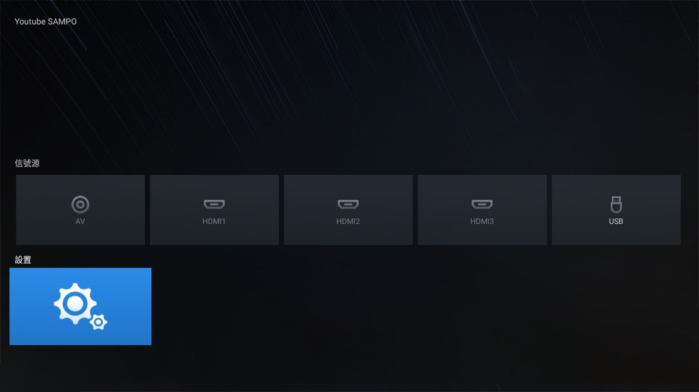 |  |

原廠主畫面是一排排訊號源和 App 方塊，設定是一格格的大圖示。Google TV 原廠主畫面則是推薦影片牆。

### 改造後：Mac TVOS

**Google TV Streamer（Android 14）**


**SAMPO 電視（Android 9）**

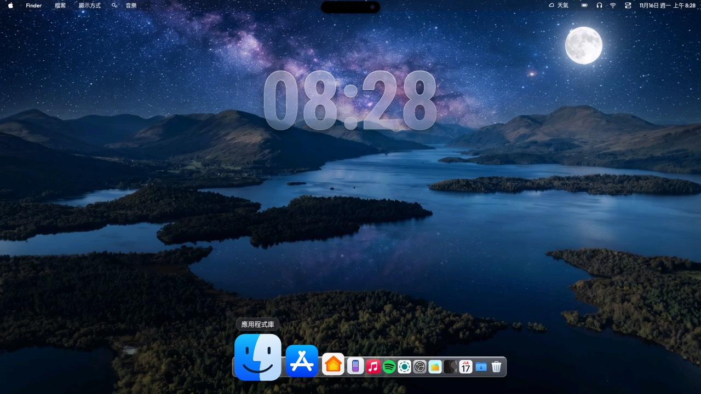

上方是 macOS 選單列（Finder、檔案、顯示方式、搜尋、音樂、天氣、耳機、Wi-Fi、控制中心、日期時間），中間是景深時鐘，下方是 Dock。兩台用同一份主題設定。

---

## 新增的功能

### Finder（選單列「檔案」）

依外觀自動切換深色／淺色。側欄有 iCloud、Android TV、內部儲存空間、網路、桌面、AirDrop、最近項目、應用程式。

| 深色 | 淺色 |
|---|---|
|  |  |

### 系統設定

側欄照 macOS 順序排列：Wi-Fi、藍牙、網路、電源、一般、輔助使用、外觀、背景圖片、桌面與 Dock、選單列、顯示器、智能助理與 Siri、Spotlight、通知、聲音、鎖定畫面、隱私權與安全性、螢幕保護程式。開啟時預設在「一般」。


### 照片

半透明玻璃視窗，跟隨外觀深淺色。「年／月／所有照片」在上方，側欄有喜好項目、最近儲存、影片、截圖、人物、最近刪除。點開單張照片會全螢幕顯示在最上層。

| 深色 | 淺色 |
|---|---|
|  | 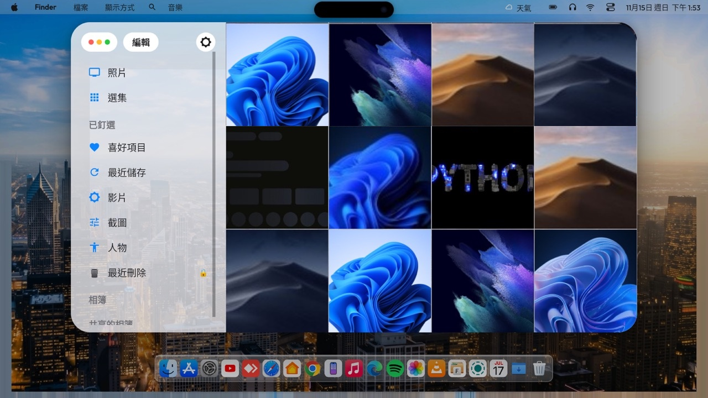 |

### 行事曆與關於這台電視

點選單列右上的日期或 Dock 的行事曆，跳出模糊桌布背景的月曆小卡；再點一次、點卡片外、按返回都會關閉。「關於這台電視」顯示型號、記憶體、儲存空間、Android 版本。


### 垃圾桶：清理暫存、垃圾檔案、一鍵提速

點 Dock 的垃圾桶，標題顯示目前記憶體用量，下面三項：

| 功能 | 做什麼 |
|---|---|
| 清理暫存 | 清主畫面自己的快取，再開系統「清除應用程式暫存檔案」，清所有 App 的快取 |
| 垃圾檔案 | 刪除內部儲存的 `.tmp`、`.temp`、`.log` 和縮圖快取（保留 `.nomedia`），再清空媒體垃圾桶 |
| 一鍵提速 | 結束其他 App 的背景程序，顯示釋放了多少記憶體 |

| 選單 | 垃圾檔案 |
|---|---|
| 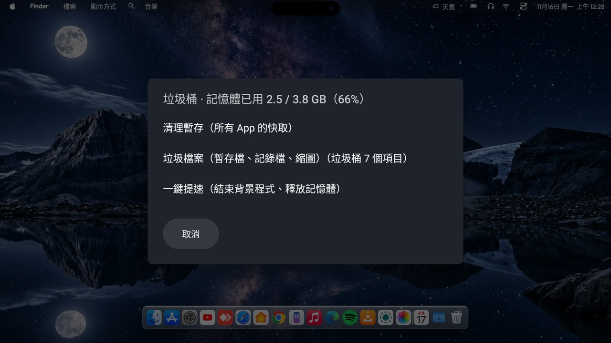 | 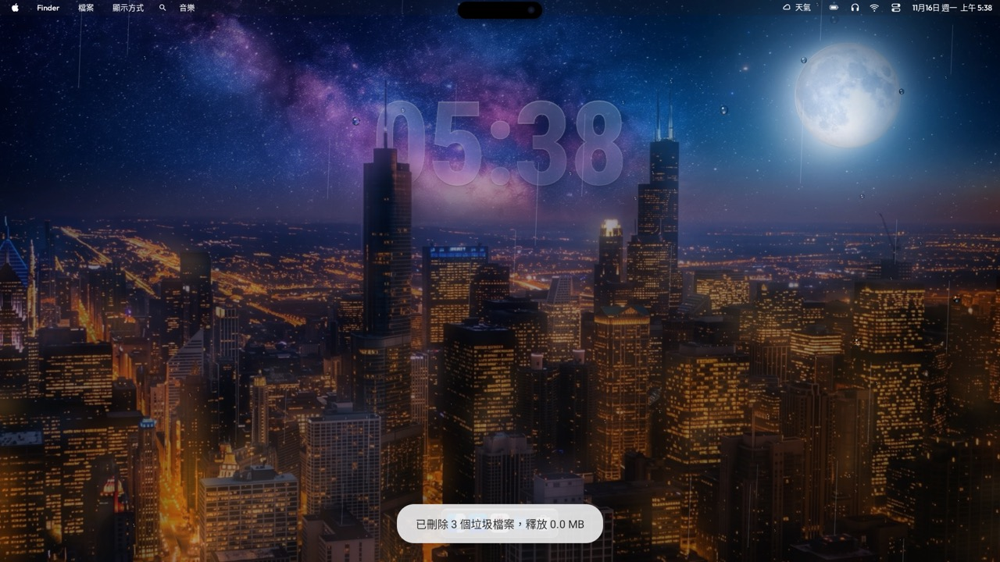 |
| **一鍵提速** | **清理暫存** |
|  | 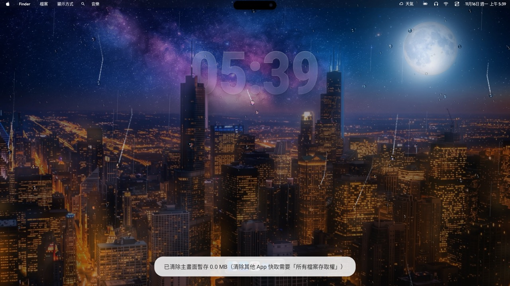 |

### AirPods 卡片

點選單列的耳機圖示，顯示藍牙耳機卡片（需要藍牙權限，安裝腳本會授予）。


### 景深時鐘

時鐘放在天空區域，被大樓擋住，看起來在建築後面。時間補零顯示（例：`08:05`），可拖動位置，「重設位置」回到置中。

| 景深遮罩修正前（數字壓在大樓上） | 修正後 |
|---|---|
| 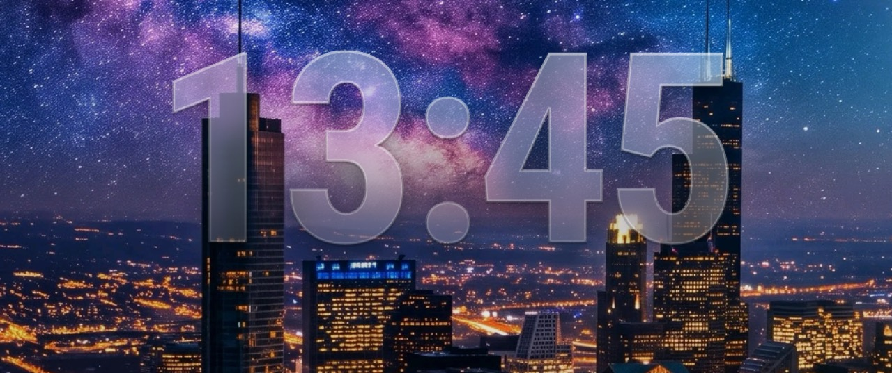 | 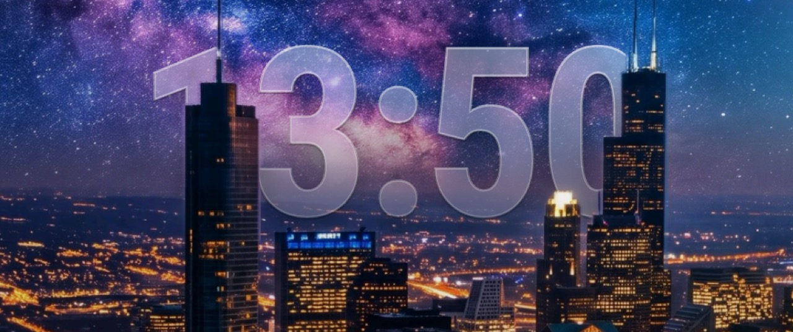 |


### 立體月亮

芝加哥夜景桌布的月亮改成邊緣漸暗、中央略亮，看起來是球體。

| 修改前 | 修改後 |
|---|---|
| 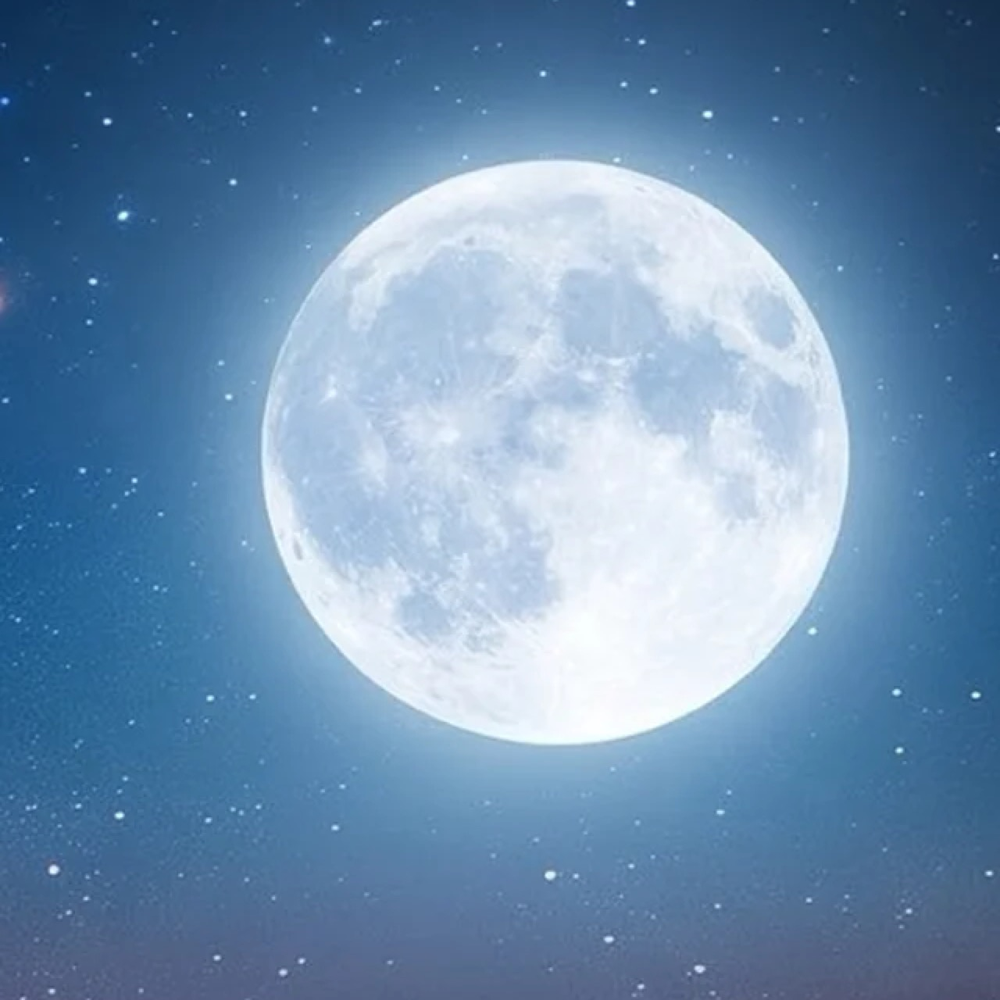 |  |

### 淺色長按選單

應用程式庫的長按選單和所有下拉選單，淺色外觀時改成淺色毛玻璃、深色字、藍色焦點列。


---

## 和原版不一樣的地方

| 項目 | 原版 4.1.3 | Mac TVOS v40 |
|---|---|---|
| 套件名 | `com.gathin.tvhome` | `com.gathin.tvnext`，可和原版並存 |
| 支援系統 | Android 11 以上功能才完整 | Android 9 以上，舊系統自動改用讀寫權限 |
| Dock | 一般 Dock | 底部 Dock、焦點放大與名稱跟隨、已釘選 App 有小圓點、行事曆與下載資料夾 |
| 應用程式庫 | 一般格狀 | 模糊背景、即時圖示、已釘選打勾、七到八欄 |
| Finder、照片、下拉選單 | 固定白底 | 跟隨深淺色 |
| 設定 | Android 順序 | macOS 順序 |
| 行事曆 | 系統對話框 | 自製模糊小卡 |
| 垃圾桶 | 從 Dock 移除、解除安裝 | 清理暫存、垃圾檔案、一鍵提速 |
| 冷啟動 | Dock 會先出現在畫面中段再跳回 | 等版面準備好才淡入，不會閃錯位 |
| 主題設定 | 只能在 App 內調 | 可用 ADB 寫入 `config.json`，一鍵套到多台電視 |
| 安裝 | `adb install` | 腳本先上傳、比對 md5、電視端安裝、授權、設主畫面 |

**多出的服務**

- **主題提供者** `content://com.gathin.tvnext.theme`：可讀寫 `config.json`、`theme_revision`，電腦端一行指令就能換主題或同步多台。
- **TrashCleaner**：清快取、清垃圾檔、結束背景程序。
- **Reveal**：冷啟動時等主執行緒穩定後再淡入畫面。
- **FinderTheme／PhotoTheme／GlassTint**：統一的深淺色判斷（含依時間自動切換）。
- **一鍵安裝腳本** `install.sh`：自動判斷 Android 版本，給對的權限。

---

## 主題設定

macOS 模式寫在主題設定 `theme-config.json`，不在 APK 預設裡。重點欄位：

| 設定 | 值 | 說明 |
|---|---|---|
| `mac_dock` | true | macOS Dock |
| `mac_settings` | true | macOS 風格設定視窗 |
| `top_menu` | true | 上方選單列 |
| `dock_glass` / `glass_style` | true / `rim` | 玻璃 Dock、亮邊 |
| `dock_opacity` | 45 | Dock 底板不透明度 |
| `dock_width_percent` | 46 | Dock 寬度占畫面比例 |
| `wallpaper` / `wallpaper_dim` | true / 20 | 顯示桌布、壓暗 20% |
| `background_color` | `#05060F` | 沒桌布時的底色 |
| `columns` | 8 | 應用程式庫欄數 |
| `square_tiles` / `uniform_tiles` | true | 圓角方形圖示、尺寸一致 |
| `reduced_motion` | true | 簡化動畫，電視盒較順 |
| `app_banners` | 清單 | 把 App 對應到 Mac 圖示，例：`com.android.vending=banner_mac_appstore` |
| `app_labels` | 清單 | 改顯示名稱，例：`com.android.gallery3d=照片` |
| `hidden_apps` | 清單 | 從應用程式庫隱藏的 App |
| `dock_apps` | 清單 | Dock 預設 App（舊電視可用來指定 Dock） |

內建 Mac 圖示：`banner_mac_safari`、`banner_mac_settings`、`banner_mac_photos`、`banner_mac_music`、`banner_mac_appstore`、`banner_mac_iphonemirror`、`banner_mac_clock`、`banner_mac_home`。

不同品牌的設定、相簿、瀏覽器套件名不同。例如 SAMPO 是 `com.kgzn.setting`、`com.kgzn.media`、`com.android.browser`，要自己加到 `app_banners`。

**外觀**：設定 →「外觀」可選深色、淺色、自動（依時間）。桌布有芝加哥夜景、雪山湖泊等內建圖，可輪播。

**套用主題**（發行包內已附腳本）：

```bash
./apply-theme.sh <電視IP>
```

它做的事等於：

```bash
adb push theme-config.json /data/local/tmp/config.json
adb shell "content write --uri content://com.gathin.tvnext.theme/config.json < /data/local/tmp/config.json"
adb shell "date +%s > /data/local/tmp/rev; content write --uri content://com.gathin.tvnext.theme/theme_revision < /data/local/tmp/rev"
adb shell am force-stop com.gathin.tvnext
```

---

## 改造過程

### 工具

| 工具 | 用途 |
|---|---|
| Android platform-tools（adb） | 連電視、安裝、截圖、授權 |
| apktool 3.x | 解包成 smali 與資源，改完再打包 |
| JRE 21 | 執行 apktool、apksigner |
| build-tools 34（zipalign、apksigner） | 對齊與簽章 |
| Claude Code | 讀 smali、改程式、實機驗證、寫紀錄 |

### 流程

1. `apktool d` 解包原版 4.1.3。
2. 改 `AndroidManifest.xml` 的套件名為 `com.gathin.tvnext`，讓它和原版並存，不會覆蓋原版資料。
3. 改 smali：每個功能新增或修改類別（例：`TrashCleaner`、`Reveal`、`FinderTheme`、`GlassTint`、`MenuCalendar`）。
4. 換套件名後，程式用套件名查圖片資源會查不到（資源表仍是舊名），要把這些地方改成固定用資源套件名，否則景深時鐘等效果會失效。
5. `apktool b` 打包 → `zipalign` → `apksigner` 用自己的金鑰簽章。
6. 安裝：先把 APK 上傳到電視、比對 md5，再在電視端 `pm install -r`（無線直接 `adb install` 曾經傳到一半導致主畫面不斷當機）。
7. 授權、設預設主畫面、寫入主題設定。
8. 每一版都在電視上截圖驗證，寫進版本紀錄。

### 演進

| 階段 | 版本 | 重點 |
|---|---|---|
| 並存測試 | v1–v7 | 獨立套件、Dock 釘選小圓點、應用程式庫七欄、日期開月曆 |
| Dock 與應用程式庫 | v8–v11 | Mac 圖示對應、磨砂應用程式庫、Dock 置底 |
| 打磨 | v22–v28 | Dock 動畫與名稱對齊、隱藏重複設定、焦點縮放 |
| 系統視窗 | v29–v30 | 設定改 macOS 順序、照片玻璃視窗與深淺色、修景深時鐘 |
| 桌布 | v31–v32 | 立體月亮 |
| 穩定性 | v33 | 冷啟動不再閃錯位、AirPods 卡片權限 |
| 實用功能 | v34–v38 | 自製行事曆、垃圾桶三項、Finder 與選單深淺色、時鐘置中 |
| 舊系統 | v39 | 支援 Android 9／10 |
| 視窗 | v40 | 設定、照片、Finder、下載視窗縮小約一成 |

| 冷啟動修正前（Dock 跑到中間） | 修正後 |
|---|---|
| 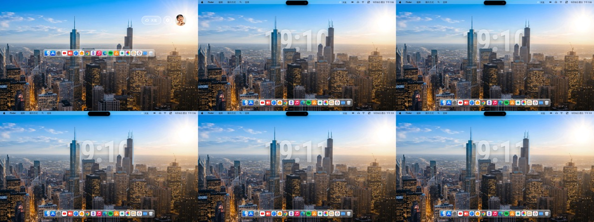 | 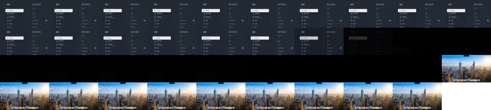 |

---

## 安裝

1. 電視：設定 → 系統 → 關於 → 連按「Android TV 作業系統版本」7 次 → 開發人員選項 → 開啟「USB 偵錯」與「網路偵錯」。查電視 IP。
2. 電腦：安裝 [platform-tools](https://developer.android.com/tools/releases/platform-tools)，解壓 `MacTVOS-v40.zip`。
3. 執行：

```bash
./install.sh <電視IP>
```

```bash
./apply-theme.sh <電視IP>
```

4. 電視跳出「允許 USB 偵錯？」時勾「一律允許」。

`install.sh` 會：上傳 APK、比對 md5（不一致自動重傳）、安裝、依 Android 版本授予檔案權限（11 以上用 appops，9／10 用 pm grant）、授予照片／藍牙權限、設為預設主畫面。

---

## 提示詞

以下提示詞貼給 Claude Code（或其他能執行指令的 AI）就能照做。改掉第一行的 IP 和資料夾。

### 1. 完整版：去臃腫 + 安裝 Mac TVOS + 檢查

```text
電視 IP：192.168.x.x（埠 5555）。安裝包位置：~/Downloads/MacTVOS-v40（改成你的資料夾）。
請當我的電視助手，用 ADB 幫我「去臃腫、安裝 Mac TVOS、檢查功能」，規則如下：

【連線】
1. 找 adb（沒有就先問我再從 Google 官方下載 platform-tools），adb connect <IP>:5555；電視跳授權就叫我按允許。連不上先 ping 和測 5555 埠，告訴我是沒開機、沒開網路偵錯還是 IP 錯。
2. 先回報：型號、Android 版本、目前主畫面 App、螢幕保護程式、可用記憶體與儲存空間、有幾個使用者帳號。

【備份，確保可還原】
3. 動手前把 `pm list packages -d` 和 `pm list packages -e` 存成本機檔案（含日期），並記下目前 HOME 與螢幕保護程式設定（`settings get secure screensaver_components`）。

【去臃腫】
4. 列出可停用的項目，分成「建議停用／看你需求／不建議動」三類。每個選項的標題直接寫出 App 名稱與套件名，不要藏在說明裡；說清楚停用後會少了什麼功能。
5. 只用 `pm disable-user --user 0`，不解除安裝系統 App；第三方 App 才可用 `pm uninstall --user 0`。全部要我勾選確認後才執行。
6. 絕對不要動：目前使用中的主畫面、輸入法、Play 服務與商店、系統設定、網路、藍牙、遙控器服務、媒體與相片相關元件（例如 com.android.gallery3d）、螢幕保護程式正在用的 App、其他使用者帳號。
7. 停用前先查依賴：主畫面、Dock、桌布、相簿、螢幕保護程式是否用到它；有疑慮就列為「不建議動」。

【安裝 Mac TVOS】（不需要就刪掉這段）
8. 先問我要不要裝。要的話執行 `install.sh <IP>`，再執行 `apply-theme.sh <IP>`。腳本失敗就改成逐條執行同樣的指令，並告訴我哪一步失敗。
9. 原廠啟動器先不要停用；確認 Mac TVOS 正常當主畫面後，再問我要不要停用原廠啟動器。
10. 裝完確認：按 HOME 回到 Mac TVOS、Dock 圖示齊全、選單列「檔案」能開、垃圾桶選單有「清理暫存／垃圾檔案／一鍵提速」、時鐘顯示 00:00 格式。

【檢查並截圖】
11. 逐項實測並截圖給我：主畫面、系統設定、YouTube、Play 商店、相簿／照片、螢幕保護程式、語音搜尋（若保留）。用 `screencap` 存在電視上再一次拉回，不要逐步來回。
12. 送按鍵前先截圖確認我沒在用電視；畫面有開著的視窗就先停，問我。啟動器設定視窗裡用方向鍵加確認鍵，不要用 tap（tap 會變成捲動）。
13. 有任何功能異常，立刻用 `pm enable <套件>` 還原該項，再回報原因。

【回報】
14. 用表格列出：已停用、已保留、已安裝、還原指令，以及備份檔位置。全程用繁體中文、精簡回答。

【可調整】
- 只想保守處理：加一句「只停用建議停用類」。
- 想更徹底：加一句「看你需求類也列給我逐項選」。
- 只去臃腫不裝啟動器：加一句「不要安裝 Mac TVOS」。
- 要保留的 App：在這裡列出 → 保留：
```

### 2. 只安裝 Mac TVOS

```text
電視 IP：192.168.x.x（埠 5555）。安裝包在 ~/Downloads/MacTVOS-v40。
請用 ADB 幫我安裝 Mac TVOS：
1. adb connect，回報型號、Android 版本、目前主畫面。
2. 先記下目前主畫面（cmd package resolve-activity -c android.intent.category.HOME），方便還原。
3. 執行 install.sh <IP>，再執行 apply-theme.sh <IP>；腳本失敗就逐條執行並告訴我哪一步失敗。
4. 原廠啟動器不要停用。
5. 截圖確認：按 HOME 回到 Mac TVOS、Dock 圖示齊全、選單列「檔案」能開、垃圾桶有三項。
6. 全程繁體中文，用表格回報，附還原指令。
```

### 3. 兩台電視同步成一樣

```text
A 電視 IP：192.168.x.x，B 電視 IP：192.168.y.y，兩台都已裝 Mac TVOS。
請把 B 調成和 A 一樣：
1. 用 content read --uri content://com.gathin.tvnext.theme/config.json 讀兩台主題設定並比對。
2. 列出 A 的 Dock 有、B 沒裝的 App，查每個 App 在 A 上的 minSdk 和 CPU 架構，告訴我哪些能直接從 A 複製到 B（pm path + adb pull，再 install-multiple）。
3. 讓我勾選要複製哪些，再安裝。
4. B 的設定、相簿、瀏覽器套件名如果不同，幫我加進 app_banners 對應到 Mac 圖示，並把 B 原本的設定先存一份。
5. 寫入後更新 theme_revision、重啟主畫面，截圖給我看。
```

### 4. 請 AI 改功能（改包）

```text
我有 Mac TVOS 的 apktool 解包資料夾（smali）。請幫我改：<要改的功能>。
規則：
1. 先找出相關的 smali 類別，說明現在怎麼運作，再動手。
2. 修改前把原檔備份成 .bak。
3. 舊 Android 沒有的 API 要用 Build.VERSION.SDK_INT 判斷，不能直接呼叫。
4. 打包 → zipalign → apksigner 用我的金鑰簽章，不要把金鑰密碼寫進任何檔案。
5. 安裝用「上傳、比對 md5、電視端 pm install -r」，不要直接 adb install。
6. 在電視上實測並截圖，沒測到的項目要明講。
```

---

## 注意事項與還原

- **一定要留一個主畫面**：停用或移除 Mac TVOS 前，先啟用原廠啟動器。
- **相片元件不要停用**（例：`com.android.gallery3d`），否則 Dock 的「照片」會消失。
- **重新安裝要重給權限**：檔案（Android 11 以上 `appops set com.gathin.tvnext MANAGE_EXTERNAL_STORAGE allow`；9／10 `pm grant` 讀寫權限）、照片、藍牙。
- **Android 10 以下**「清理暫存」只能清主畫面自己的快取，提示文字仍寫「需要所有檔案存取權」，不影響使用。
- 新裝的 App 不會自動換成 Mac 圖示，要加到 `app_banners`。

換回原廠主畫面（Google TV 為例）：

```bash
adb shell pm enable com.google.android.apps.tv.launcherx
```

```bash
adb shell cmd package set-home-activity com.google.android.apps.tv.launcherx/com.google.android.apps.tv.launcherx.home.HomeActivity
```

```bash
adb shell pm uninstall com.gathin.tvnext
```

---

## 版本紀錄

- **v40**（2026-11-16）：設定、照片、Finder、下載視窗開啟時縮小約一成，四周露出桌布，照片不再蓋住 Dock（設定四周邊距 96／60 dp；照片 72%×70%；Finder 60%；下載 56%×60%）。
- **v39**（2026-11-16）：支援 Android 9／10。安裝腳本依版本給權限；垃圾檔案在舊系統不再閃退；移除舊系統多跳的媒體權限提示。
- **v38**：Finder、下拉選單、長按選單跟隨深淺色；垃圾桶改三項；景深時鐘置中、時間補零。
- **v37**：自製行事曆小卡；垃圾桶一鍵清理與記憶體顯示；關於這台電視漸層加深。
- **v33**：冷啟動等版面準備好才淡入；AirPods 卡片權限；照片淺色修正。
- **v32**：月亮邊緣漸暗。
- **v30**：照片跟隨深淺色；修正換套件名後景深時鐘失效。
- **v29**：設定改 macOS 順序；照片深色玻璃視窗。
- **v22–v28**：Dock 動畫、名稱對齊、焦點縮放、隱藏重複設定。
- **v8–v11**：Mac 圖示對應、磨砂應用程式庫、Dock 置底。
- **v1–v7**：獨立套件並存、Dock 釘選小圓點、應用程式庫七欄、月曆入口。
