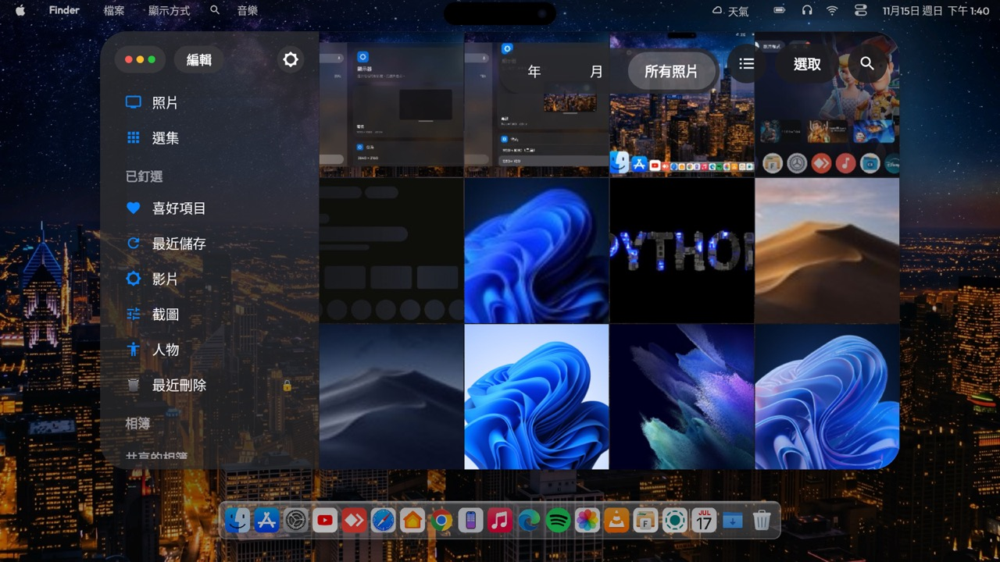
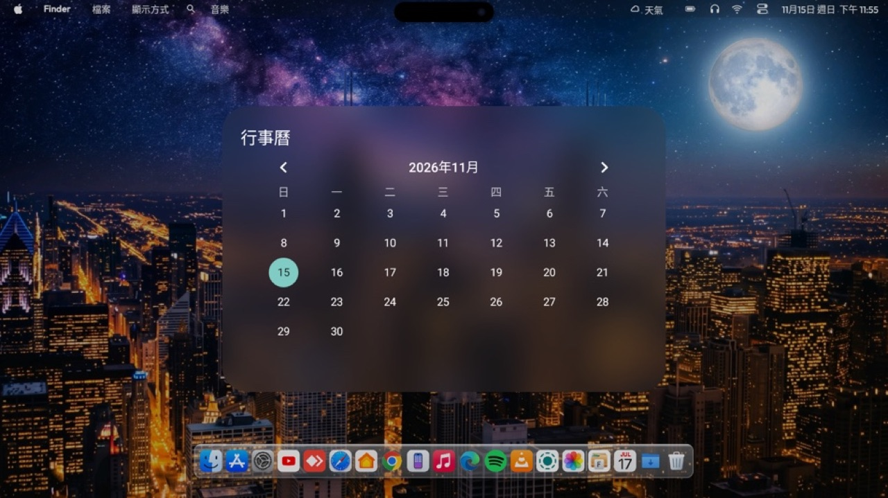
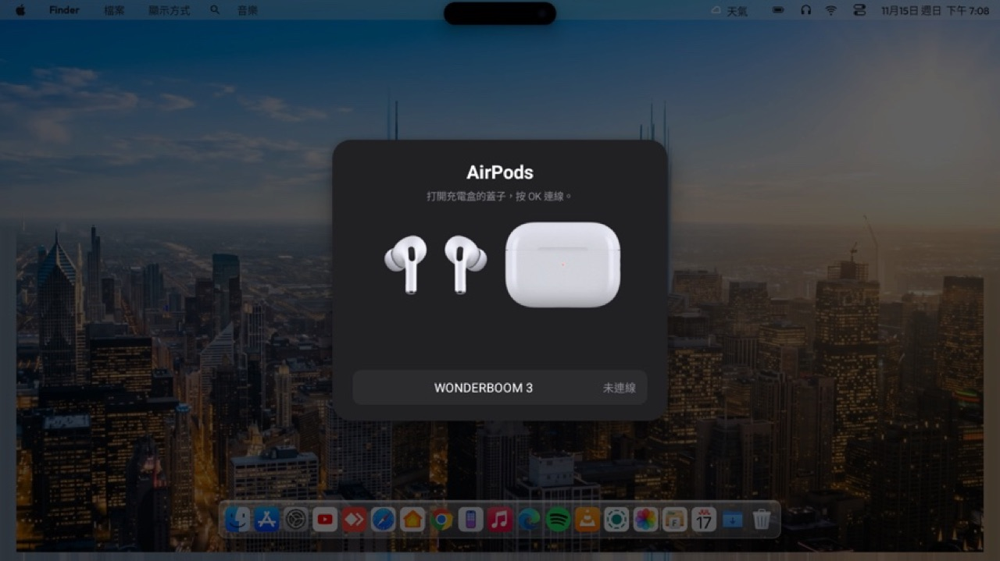
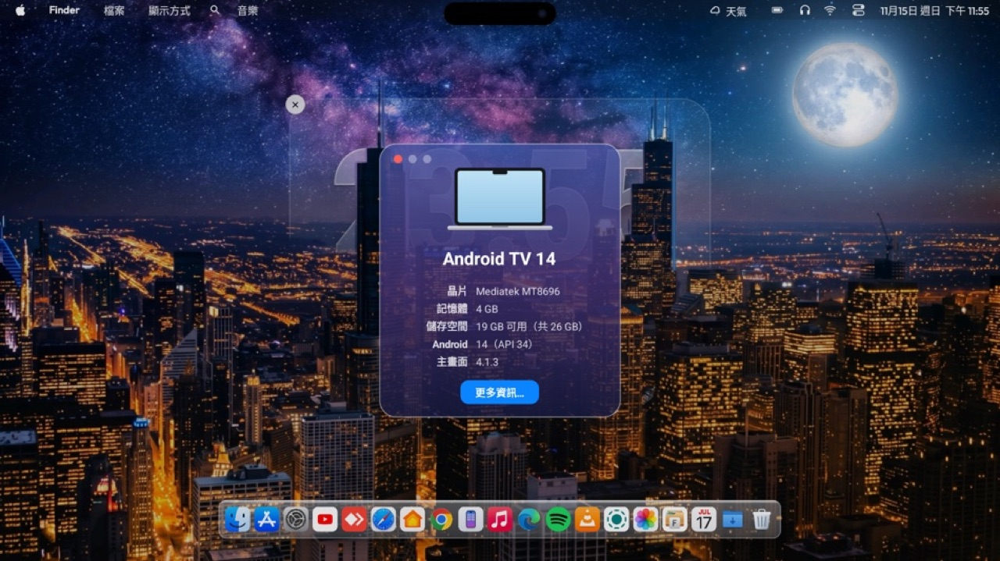

<div align="center">

# Mac TVOS

**把 Android TV／Google TV 的主畫面，變成 macOS。**

<sub>選單列・Dock・Finder・系統設定・照片・行事曆・景深時鐘　全部用遙控器操作</sub>

<br>

[](../../releases/latest)&nbsp;&nbsp;&nbsp;&nbsp;

</div>

<br>

https://github.com/user-attachments/assets/17f6c6da-5149-4c28-ba48-f7c0a5587ff6

<br>

## 三步安裝

> 需要一台電腦（macOS／Linux）和 [adb](https://developer.android.com/tools/releases/platform-tools)，電視開啟「開發人員選項 → 網路偵錯」。

**1.** 下載 [`MacTVOS-v40.zip`](../../releases/latest) 並解壓縮

**2.** 安裝並設為主畫面

```bash
./install.sh 電視IP
```

**3.** 套用 macOS 主題

```bash
./apply-theme.sh 電視IP
```

<sub>電視跳出「允許 USB 偵錯？」時選「一律允許」。支援 Android 9 以上。</sub>

## 改造前後

<table>
<tr>
<td width="50%"><br><sub><b>改造前</b>　原廠主畫面</sub></td>
<td width="50%"><br><sub><b>改造後</b>　Mac TVOS</sub></td>
</tr>
</table>

## 畫面

<table>
<tr>
<td width="50%"><br><sub><b>Finder　深色</b></sub></td>
<td width="50%"><br><sub><b>Finder　淺色</b></sub></td>
</tr>
<tr>
<td width="50%"><br><sub><b>系統設定</b></sub></td>
<td width="50%"><br><sub><b>照片</b></sub></td>
</tr>
<tr>
<td width="50%"><br><sub><b>行事曆</b></sub></td>
<td width="50%"><br><sub><b>AirPods 卡片</b></sub></td>
</tr>
<tr>
<td width="50%"><br><sub><b>關於這台電視</b></sub></td>
<td width="50%"><br><sub><b>照片　淺色</b></sub></td>
</tr>
<tr>
<td width="50%"><br><sub><b>垃圾桶</b></sub></td>
<td width="50%"><br><sub><b>一鍵提速</b></sub></td>
</tr>
<tr>
<td width="50%"><br><sub><b>景深時鐘</b></sub></td>
<td width="50%"><br><sub><b>淺色選單</b></sub></td>
</tr>
</table>

## 提示詞

把下面任一段貼給 Claude Code（或其他能執行指令的 AI），改掉第一行的 IP，就能自動完成。

<details>
<summary><b>完整版｜去臃腫＋安裝＋功能檢查</b></summary>

```text
電視 IP：192.168.x.x（埠 5555）。安裝包位置：~/Downloads/MacTVOS-v40（改成你的資料夾）。
請當我的電視助手，用 ADB 幫我「去臃腫、安裝 Mac TVOS、檢查功能」，規則如下：

【連線】
1. 找 adb（沒有就先問我再從 Google 官方下載 platform-tools），adb connect <IP>:5555；電視跳授權就叫我按允許。連不上先 ping 和測 5555 埠，告訴我是沒開機、沒開網路偵錯還是 IP 錯。
2. 先回報：型號、Android 版本、目前主畫面 App、螢幕保護程式、可用記憶體與儲存空間、有幾個使用者帳號。

【備份，確保可還原】
3. 動手前把 `pm list packages -d` 和 `pm list packages -e` 存成本機檔案（含日期），並記下目前 HOME 與螢幕保護程式設定（`settings get secure screensaver_components`）。

【去臃腫】
4. 列出可停用的項目，分成「建議停用／看你需求／不建議動」三類。每個選項的標題直接寫出 App 名稱與套件名，不要藏在說明裡；說清楚停用後會少了什麼功能。
5. 只用 `pm disable-user --user 0`，不解除安裝系統 App；第三方 App 才可用 `pm uninstall --user 0`。全部要我勾選確認後才執行。
6. 絕對不要動：目前使用中的主畫面、輸入法、Play 服務與商店、系統設定、網路、藍牙、遙控器服務、媒體與相片相關元件（例如 com.android.gallery3d）、螢幕保護程式正在用的 App、其他使用者帳號。
7. 停用前先查依賴：主畫面、Dock、桌布、相簿、螢幕保護程式是否用到它；有疑慮就列為「不建議動」。

【安裝 Mac TVOS】（不需要就刪掉這段）
8. 先問我要不要裝。要的話執行 `install.sh <IP>`，再執行 `apply-theme.sh <IP>`。腳本失敗就改成逐條執行同樣的指令，並告訴我哪一步失敗。
9. 原廠啟動器先不要停用；確認 Mac TVOS 正常當主畫面後，再問我要不要停用原廠啟動器。
10. 裝完確認：按 HOME 回到 Mac TVOS、Dock 圖示齊全、選單列「檔案」能開、垃圾桶選單有「清理暫存／垃圾檔案／一鍵提速」、時鐘顯示 00:00 格式。

【檢查並截圖】
11. 逐項實測並截圖給我：主畫面、系統設定、YouTube、Play 商店、相簿／照片、螢幕保護程式、語音搜尋（若保留）。用 `screencap` 存在電視上再一次拉回，不要逐步來回。
12. 送按鍵前先截圖確認我沒在用電視；畫面有開著的視窗就先停，問我。啟動器設定視窗裡用方向鍵加確認鍵，不要用 tap（tap 會變成捲動）。
13. 有任何功能異常，立刻用 `pm enable <套件>` 還原該項，再回報原因。

【回報】
14. 用表格列出：已停用、已保留、已安裝、還原指令，以及備份檔位置。全程用繁體中文、精簡回答。

【可調整】
- 只想保守處理：加一句「只停用建議停用類」。
- 想更徹底：加一句「看你需求類也列給我逐項選」。
- 只去臃腫不裝啟動器：加一句「不要安裝 Mac TVOS」。
- 要保留的 App：在這裡列出 → 保留：
```

</details>

<details>
<summary><b>只安裝 Mac TVOS</b></summary>

```text
電視 IP：192.168.x.x（埠 5555）。安裝包在 ~/Downloads/MacTVOS-v40。
請用 ADB 幫我安裝 Mac TVOS：
1. adb connect，回報型號、Android 版本、目前主畫面。
2. 先記下目前主畫面（cmd package resolve-activity -c android.intent.category.HOME），方便還原。
3. 執行 install.sh <IP>，再執行 apply-theme.sh <IP>；腳本失敗就逐條執行並告訴我哪一步失敗。
4. 原廠啟動器不要停用。
5. 截圖確認：按 HOME 回到 Mac TVOS、Dock 圖示齊全、選單列「檔案」能開、垃圾桶有三項。
6. 全程繁體中文，用表格回報，附還原指令。
```

</details>

<details>
<summary><b>兩台電視同步成一樣</b></summary>

```text
A 電視 IP：192.168.x.x，B 電視 IP：192.168.y.y，兩台都已裝 Mac TVOS。
請把 B 調成和 A 一樣：
1. 用 content read --uri content://com.gathin.tvnext.theme/config.json 讀兩台主題設定並比對。
2. 列出 A 的 Dock 有、B 沒裝的 App，查每個 App 在 A 上的 minSdk 和 CPU 架構，告訴我哪些能直接從 A 複製到 B（pm path + adb pull，再 install-multiple）。
3. 讓我勾選要複製哪些，再安裝。
4. B 的設定、相簿、瀏覽器套件名如果不同，幫我加進 app_banners 對應到 Mac 圖示，並把 B 原本的設定先存一份。
5. 寫入後更新 theme_revision、重啟主畫面，截圖給我看。
```

</details>

<details>
<summary><b>請 AI 幫你改功能</b></summary>

```text
我有 Mac TVOS 的 apktool 解包資料夾（smali）。請幫我改：<要改的功能>。
規則：
1. 先找出相關的 smali 類別，說明現在怎麼運作，再動手。
2. 修改前把原檔備份成 .bak。
3. 舊 Android 沒有的 API 要用 Build.VERSION.SDK_INT 判斷，不能直接呼叫。
4. 打包 → zipalign → apksigner 用我的金鑰簽章，不要把金鑰密碼寫進任何檔案。
5. 安裝用「上傳、比對 md5、電視端 pm install -r」，不要直接 adb install。
6. 在電視上實測並截圖，沒測到的項目要明講。
```

</details>

## 常見問題

<details>
<summary><b>想換回原廠主畫面</b></summary>

```bash
adb shell pm enable com.google.android.apps.tv.launcherx
adb shell cmd package set-home-activity com.google.android.apps.tv.launcherx/com.google.android.apps.tv.launcherx.home.HomeActivity
adb shell pm uninstall com.gathin.tvnext
```

</details>

<details>
<summary><b>重新安裝後照片、垃圾桶不能用</b></summary>

再執行一次 `./install.sh 電視IP`，它會自動補上檔案、照片與藍牙權限。

</details>

<details>
<summary><b>新裝的 App 沒有 Mac 圖示</b></summary>

在 `theme-config.json` 的 `app_banners` 加一行，例如 `com.android.vending=banner_mac_appstore`，再執行 `./apply-theme.sh 電視IP`。

</details>

<details>
<summary><b>注意事項</b></summary>

- 一定要留一個主畫面：停用 Mac TVOS 前先啟用原廠啟動器。
- 不要停用相片元件（例如 `com.android.gallery3d`），否則 Dock 的「照片」會消失。
- Android 10 以下的「清理暫存」只會清主畫面自己的快取。

</details>

<br>

<div align="center"><sub>Mac TVOS · 實測：Google TV Streamer（Android 14）、SAMPO 聯網電視（Android 9）</sub></div>
